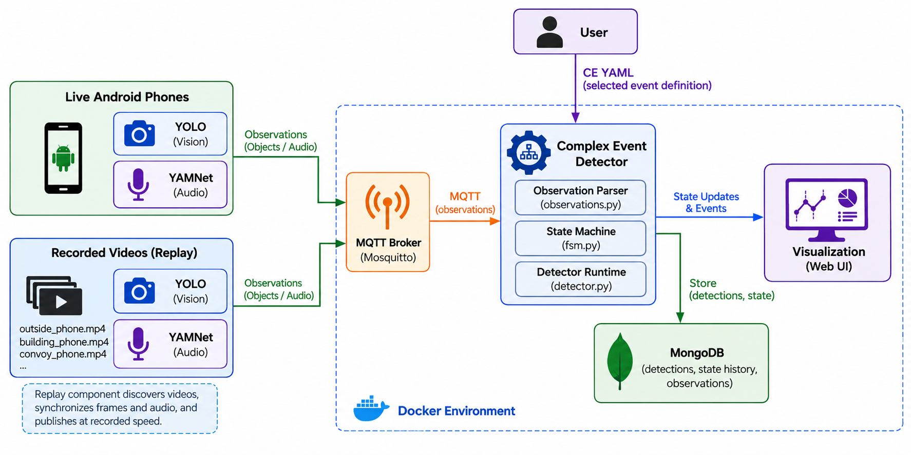

# Mobile Data Collector

Mobile Data Collector detects complex events from live Android phones or from
recorded videos. Both inputs follow the same path: YOLO/YAMNet detections are
published through MQTT and evaluated against a YAML complex-event (CE)
definition.



See [Architecture and replay flow](docs/architecture.md) for the complete live
and recorded-video design.

## Quick start

Requirements:

- Docker with Docker Compose
- Video files, or Android phones running the collector app

Choose a CE and start the receiver stack:

```bash
./run ce3
```

This starts MQTT, MongoDB, the device registry, visualization, and the CE
detector. `ce3` is shorthand for `ce_definitions/iobt_ce3.yaml`. Run
`./run list` to see the other available definitions.

Open the visualization at <http://localhost:5000>.

## Replay recorded videos

Put one or more synchronized videos in a folder:

```text
convoy-recording/
├── outside_phone.mp4
├── building_phone.mp4
└── convoy_phone.mp4
```

Each filename, without the extension, becomes its device ID. These names must
match the devices in the selected CE definition. All videos are assumed to
start at the same time.

With the receiver running in Terminal 1, start replay in Terminal 2:

```bash
./run replay /path/to/convoy-recording
```

That is the complete replay setup. No replay manifest or network plan is
needed. The folder may contain one video or many videos, and subfolders are
searched automatically. Supported formats are MP4, MOV, MKV, AVI, M4V, and
WebM.

Replay:

- processes video with the bundled YOLO model;
- processes each video's embedded audio with YAMNet;
- keeps all files on one synchronized timeline; and
- publishes detections through MQTT exactly as live phones do.

Replay does not require NetWaggle.

## Use live phones

On each phone, configure:

- **MQTT server:** the laptop's LAN IP address
- **MQTT port:** `1883`
- **Device ID:** a device name from the selected CE YAML

Do not use `localhost` on a physical phone. Start the receiver with `./run ce3`,
then press **toggle record** in the app. No replay terminal is needed for live
phones.

## Define a complex event

CE definitions live in `ce_definitions/`. A definition declares its device
names, atomic detection triggers, ordering, and timing constraints.

For example:

```bash
./run gunshot
```

starts the stack with `ce_definitions/gunshot.yaml`. See the
[CE language guide](event-detector/language/README.md) for the YAML format.

## Architecture

Live phones and video replay share one observation path:

```text
live phones ─┐
             ├─> MQTT ─> CE detector ─> MongoDB + visualization
video replay ┘
```

The complete flow, replay synchronization, and five core implementation files
are described in [docs/architecture.md](docs/architecture.md).

## Repository layout

```text
android-app/       Android camera and microphone collector
ce_definitions/    Complex-event YAML files
docs/              Architecture figure
event-detector/    Replay, CE detection, services, and language parser
docker-compose.yml Runtime services
mosquitto.conf     MQTT configuration
run                Start, replay, list, logs, or stop
```

## Useful commands

```bash
./run list          # list CE definitions
./run logs          # follow detector output
./run stop          # stop the services
```

MongoDB data is retained between runs. The development MQTT configuration is
unauthenticated and should only be used on a trusted local network.

## Build the Android app

Building the app is optional. With Android SDK tools and JDK 17 installed:

```bash
cd android-app
./gradlew assembleDebug
```

The APK is written to
`android-app/app/build/outputs/apk/debug/app-debug.apk`.
